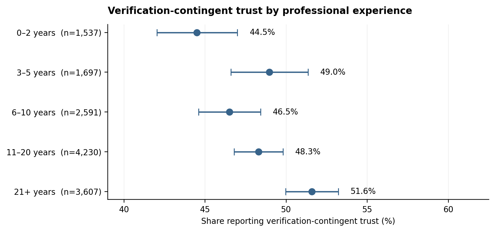
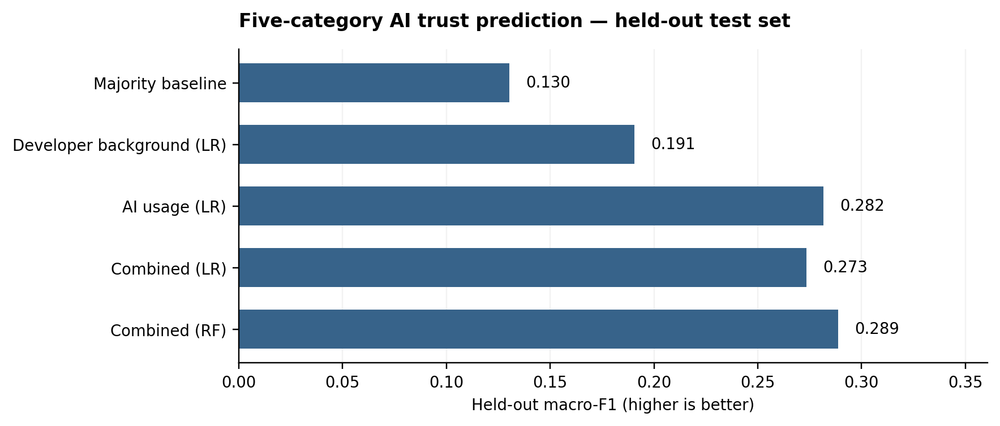
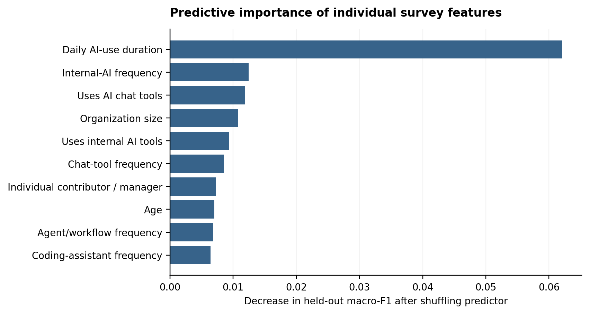

# Beyond Code Generation: Task-Specific Experiences, Trust, and Skill Concerns in AI-Assisted Programming
 Copy

**Reproducible machine-learning analysis of the Stack Overflow Developer Survey 2026**  
Research companion to the manuscript *Beyond Code Generation: How AI Coding Assistants Reshape Programming Experience, Understanding, and Developer Autonomy* (prepared for PX/27).

## Research question

Can developers' professional backgrounds and self-reported patterns of AI tool usage help predict their **self-reported trust in AI outputs**?

The dependent variable (`AITrust`) refers to trust in **AI tools and AI agents generally**, not experimentally observed accuracy of generated code or objective software development skill.

## Data and attribution

- **Source:** [Stack Overflow Developer Survey 2026](https://github.com/StackExchange/Survey/tree/main/packages/archive/2026) — Stack Exchange Inc.
- **Source file:** [`survey_results_public.csv`](https://github.com/StackExchange/Survey/blob/main/packages/archive/2026/survey_results_public.csv).
- **Expected SHA-256:** `ad520b4d5d71f240141e63f0d6f81a3b1898cbdc69efe9ea985496533b15fc2c`.
- **Source dataset:** 30,903 respondents. Of those, 14,304 answered `AITrust`; 14,230 selected one of five substantive trust categories and enter the main analysis.
- **Survey dataset license:** [ODbL 1.0](https://opendatacommons.org/licenses/odbl/1-0/); individual database contents are covered by DbCL 1.0, as stated by Stack Exchange.

**The original respondent-level dataset is not included here.** Download the official CSV yourself; keep it locally in `data/survey_results_public.csv`. This repo intentionally excludes respondent-level responses.

## Results at a glance

The study evaluates five predictors using a stratified **80/20 train/test split**, **three-fold cross-validation** on the training set, and **macro-F1** as the primary test metric.

| Model | Held-out macro-F1 | Held-out accuracy | Balanced accuracy |
| --- | ---: | ---: | ---: |
| Majority-class baseline | 0.130 | **0.483** | 0.200 |
| Developer background (Logistic Regression) | 0.191 | 0.190 | 0.261 |
| AI usage (Logistic Regression) | 0.282 | 0.297 | **0.353** |
| Combined (Logistic Regression) | 0.273 | 0.277 | 0.344 |
| Combined (Random Forest) | **0.289** | 0.301 | 0.351 |

Training: **11,384** respondents; held-out testing: **2,846** respondents. Combined Random Forest bootstrap 95% confidence interval for macro-F1: **0.274–0.307** (400 resamples).

**Interpretation:** The best model improves multiclass macro-F1 over the majority baseline, but the baseline has higher overall accuracy. Predictive performance remains modest; it would be incorrect to claim reliable individual prediction.

A separate experience-group analysis found a **small association** between professional experience and the distribution of trust categories (Cramér's V = 0.051). A code-primary sensitivity analysis covers 11,391 respondents.

## Figures

**Paper figures:** Literature evidence map (Figure 1), trust by experience (Figure 2), model comparison (Figure 3), predictor importance (Figure 4), and matched programming-task satisfaction (Figure 5).

| Figure | Explanation |
| --- | --- |
|  | Descriptive conditional-trust proportions and confidence intervals |
|  | Held-out macro-F1 comparison between five approaches |
|  | Holdout permutation importance for the combined Logistic Regression model |

## Reproduce the experiment

**Requirements:** Python 3.11+; packages are listed with the versions from the executed environment in `requirements.txt` (installation can vary by Python version/platform).

1. Download the official `survey_results_public.csv` from the source link above and place it at `data/survey_results_public.csv` (create the `data` folder locally).
2. Install the dependencies:

   ```bash
   python -m pip install -r requirements.txt
   ```

3. Reproduce the main analysis:

   ```bash
   python src/run_analysis.py data/survey_results_public.csv --output outputs/full
   ```

4. Reproduce the code-primary sensitivity analysis:

   ```bash
   python src/run_analysis.py data/survey_results_public.csv --output outputs/code_primary --code-primary
   ```

The random seed is 42. Preprocessing is fitted within the training procedure. The input SHA-256 is listed above so that the public dataset version can be checked. Figures and tables in `results/` and `figures/` were produced by the original analysis and are supplied for auditability.

On Windows, you may need to run `py` instead of `python`.

## Repository layout

```text
README.md
requirements.txt
.gitignore
src/
  run_analysis.py
  programming_task_satisfaction.py
  skill_concerns_analysis.py
results/
  Table_Model_Results.csv
  Table_Developer_Only_Sensitivity.csv
  Table_Trust_by_Experience.csv
  Table_Permutation_Importance.csv
  Table_Trust_Response_Counts.csv
  Table_Confusion_Matrix_Combined_LR.csv
  *_classification.csv
  Run_Metadata.json
  Table_Programming_Task_Satisfaction.csv
  Table_Paired_Programming_Task_Contrasts.csv
  Table_Skill_Concerns_By_Experience.csv
  Execution_Log.txt
figures/
  Figure_2_Trust_by_Experience.png
  Figure_3_ML_Comparison.png
  Figure_4_Predictor_Importance.png
  Figure_1_Evidence_Map_ACM.png
  Figure_5_Programming_Tasks_Paired.png
```

## Additional PX/27 programming-experience analyses (November 2026)

The companion paper adds a **matched, task-level analysis** of developers whose main job involves writing code. Three AI-satisfaction items were compared **within the same respondents**, avoiding differences caused by using separate participant groups. The survey measures changes in **self-reported satisfaction**, not objective speed, learning or skill loss.

### Task-specific findings

Among **9,448 code-primary respondents** who answered all three relevant questions:

| Development activity | Reported improved satisfaction |
| --- | ---: |
| Debugging / refactoring | **66.6%** (6,292 / 9,448) |
| Implementation | 59.9% (5,659 / 9,448) |
| Code review | 55.0% (5,198 / 9,448) |

* Matched debugging minus implementation difference: **6.7 percentage points** (approximate 95% CI **5.7–7.7**).
* Matched debugging minus code-review difference: **11.6 percentage points** (approximate 95% CI **10.5–12.6**).
* Both comparisons had exact paired-discordance test p-values below 0.001. For the full set of **11,634** respondents who completed all three items, the corresponding differences were **5.8** and **10.7** points.

The code-primary results appear in `results/Table_Programming_Task_Satisfaction.csv` and `results/Table_Paired_Programming_Task_Contrasts.csv` and the paper's Figure 5 is `figures/Figure_5_Programming_Tasks_Paired.png`.

### Professional skill/replacement concern

The 2026 `AIAvoid` response category **“Concern over losing job skills or training an AI to replace you”** was reported by **28.9%** of eligible code-primary respondents with 0–2 years of professional experience versus **9.7%** with 21+ years. This is a selected **concern**, not evidence that any respondent's programming skills declined. The response item combines two motivations that cannot be separated using this item. The complete five-band table is `results/Table_Skill_Concerns_By_Experience.csv`.

### Reproduce the additional analyses

Use the **same official dataset** described above. Place it locally at `data/survey_results_public.csv`; `data/` is ignored by Git.

```bash
python src/programming_task_satisfaction.py data/survey_results_public.csv --output outputs/programming_tasks
python src/skill_concerns_analysis.py data/survey_results_public.csv --output outputs/skill_concerns.csv
```

The first command produces a reproduced Figure 5 and the two matched-task CSVs. The second produces the skill-concern CSV. The checked-in Figure 5 preserves the exact image used in the manuscript; a regenerated figure may differ slightly in typographic styling. Script results reproduce the same underlying percentages and comparisons.

The reproducibility files do **not** contain the original participant-level dataset, personal responses, or a trained classifier pickle. All numeric results come from public respondent-level records. The additional Figure 1 file shows the manuscript's **qualitative evidence map**; it is a research-synthesis diagram rather than a statistical plot.

## Limitations

This is an **exploratory, observational, cross-sectional secondary analysis** of a self-selected survey. The models characterize correlations in responses rather than causal effects. The data do **not** directly measure code comprehension, long-term skill retention, programming autonomy, or code quality. Trust in AI tools generally should not be conflated with trust in coding assistants specifically. Survey missingness and skip patterns may affect the predictive associations. Predictions are not evidence of changes in programming skill.

## Availability and status

This repository provides code and analysis outputs accompanying a manuscript **in preparation**. It is not an official Stack Overflow repository or an endorsement by Stack Exchange. No code license has been selected yet; add a repository license if you wish to grant reuse rights. The source survey retains its own licensing and attribution requirements.
